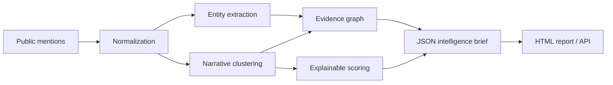

# ReputationGraph

**Explainable reputation intelligence for public-interest monitoring.**

ReputationGraph turns source-backed public mentions into an inspectable risk
brief. It extracts entities, groups recurring narratives, builds a relationship
graph, and scores emerging reputation risks without hiding the reasoning behind
an opaque model.

> ReputationGraph is for research, communications preparedness, and defensive
> monitoring. It is not designed for fake reviews, coordinated manipulation,
> harassment, or suppressing legitimate reporting.

## What the demo does

- ingests a portable JSON mention format;
- detects organizations, people, topics, and recurring narratives;
- computes a transparent `0–100` risk score from sentiment, reach, recency,
  source diversity, and corroboration;
- emits an entity–narrative graph as JSON;
- produces a standalone HTML intelligence brief;
- exposes the same pipeline through a FastAPI endpoint.

## Quick start

```bash
python -m venv .venv
source .venv/bin/activate
pip install -e '.[dev]'
reputationgraph analyze examples/mentions.json --subject "Northstar Mobility" --output brief.html
open brief.html
```

Run the API:

```bash
uvicorn reputationgraph.api:app --reload
curl -X POST http://127.0.0.1:8000/v1/analyze \
  -H 'content-type: application/json' \
  --data @examples/request.json
```

Or use Docker:

```bash
docker compose up --build
```

## Explainable scoring

Each narrative receives component scores and an explanation:

```text
risk = 35% negative tone + 20% reach + 20% recency
     + 15% source diversity + 10% corroboration
```

The weights are versioned and visible in
[`src/reputationgraph/scoring.py`](src/reputationgraph/scoring.py). This demo
uses deterministic heuristics so every result is reproducible and auditable.
Production deployments can replace individual pipeline ports with trained NLP
models or licensed data connectors while preserving the evidence contract.

## Architecture



See [`docs/ARCHITECTURE.md`](docs/ARCHITECTURE.md) for design boundaries and
extension points.

## Development

```bash
pip install -e '.[dev]'
ruff check .
pytest
```

## License

Apache-2.0. See [`LICENSE`](LICENSE).
